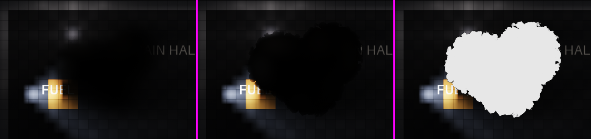

# Smoke look "r1b": kept as a candidate second smoke type (2026-10-20)



*Left: the pre-G1 erosion look. Middle: r1b. Right: r1b's coverage mask.*

**Erik, 2026-10-20:** "I love it so much... could we store this as a separate kind of smoke, to revisit? Perhaps if an oilfield is burning." He does **not** want it for the main smoke; G1's lit relief stays for that. It is not ordered yet: it is kept here so it can be rebuilt.

r1b was an **uncommitted** intermediate of G1 step 1 (20:50 on 2026-10-19, before `79e77d6`). The recipe below is the G1 implementer's account from memory, not re-rendered.

## What it was

- **Coverage:** a fixed-e-fold billow push on ln τ, one uniform edge width, no gradient term, no soft fallback, and **no haze share** (everything outside the edge is cut):
  ```glsl
  float coverageOf(float tau_ext, float b) {
      float q = log(max(tau_ext, 1e-6) / u_cov_tau)
              + u_cov_push * (b - u_billow_mean);
      return smoothstep(-0.5 * u_cov_width, 0.5 * u_cov_width, q);
  }
  float alpha = 1.0 - exp(-tau_abs * C);
  vec3 rgb = glow * C;          // no surface lighting at all
  ```
- **Dials (soot / ceiling group):**

  | Dial | Value |
  |---|---|
  | `cov_tau` | 1.0 |
  | `cov_width` | 0.5 e-folds |
  | `cov_push` | 3.0 e-folds per unit of (B − mean) |
  | `billow_cell_tiles` | 0.75 |
  | `billow_octaves` | 3 |
  | `warp_tiles` | 0.15 |
  | `drift_cap_tiles` | 1.5 |

  The smooth phase jitter was already in.
- **Why it is jet black:** there is no surface term. The colour is only the sweep's in-scatter × C, and soot's in-scatter is about 0.
- **Billow bake:** Worley cells used a hard minimum, before the `_CREASE_SMOOTH = 0.12` smoothing was added. This gives the sharper cauliflower lobes.

## Rebuilding it

- **Dials alone on the merged code get only close:**
  - `haze_ceiling = 0`, `billow_cell_tiles = 0.75`
  - A large `cov_push_tiles` with small `cov_edge_tiles` and `cov_soft_ceiling`
  - `top_light_ceiling = rim = powder = height_tiles = 0`

  These dials can't fully get there, because of three things:
  - the gradient-dependent push and width, which make flat regions go soft
  - the remaining 0.06-reflectance surface, which reads as charcoal near lamps
  - the crease smoothing, which is a code constant
- **Exact r1b:** a render-only "look table" (`[render.smoke_looks.<name>]`: coverage mode, lit/unlit, crease smoothing, billow scale) with a gas → look mapping. The relief groups become (layer, look) pairs, plus a `u_look` branch in `gas_relief.fs` and a hard-crease billow bake. That is about one session.
- **A real new gas** (e.g. `[gases.oil_smoke]`) is sim-side. It adds a trace plane, which means `N_TRACE_GASES`, transport, digests and goldens, so it is a physics-session decision.
- **Cheapest interim:** a per-level look mapping (an oilfield level draws `smoke` as r1b). Render-only.
