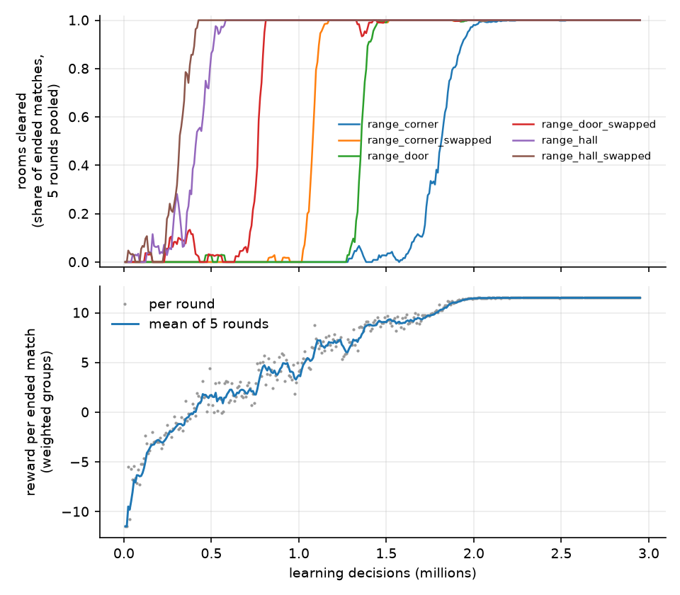
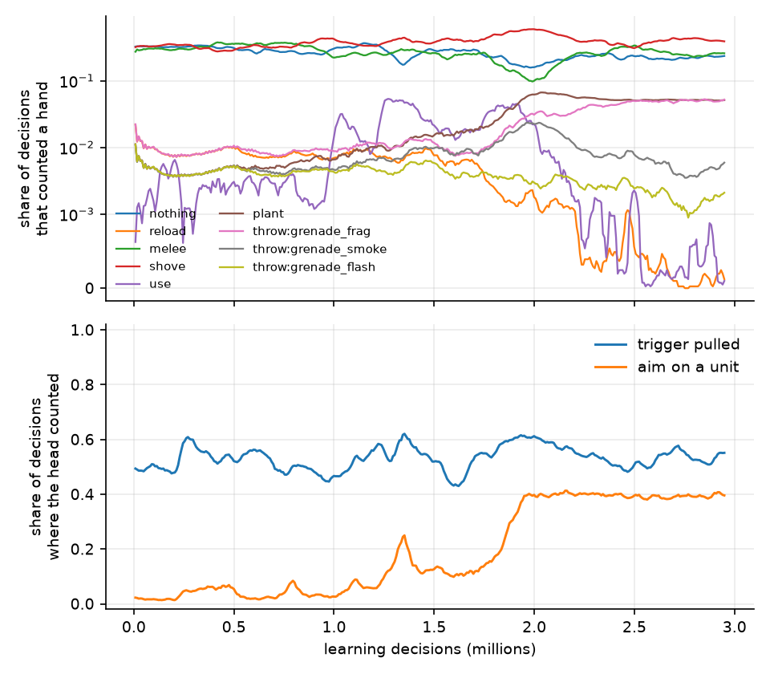
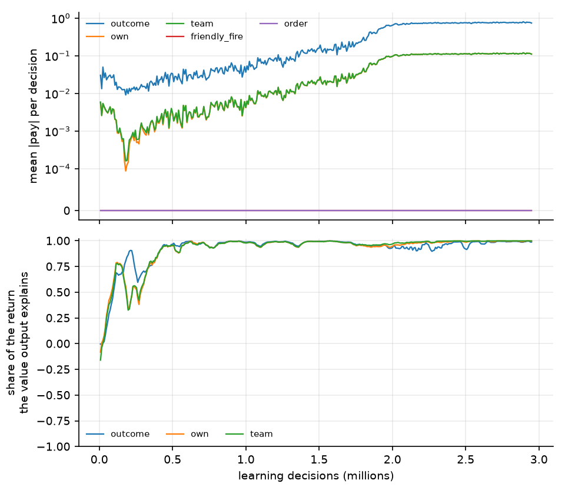

# RL agent, rung 2, patch 2c: the first real run (the report)

2026-11-17, the lead's. The note is `docs/rl_agent_rung2_note_2c_2026-11-17.md`;
the design is `docs/rl_agent_rung2_design_2026-11-14.md`. The figures are in
`docs/rl_agent_rung2_report_2c_2026-11-17/`.

**Who played whom.** ONE untrained soldier (a rifleman, the full-width
network without memory, from random weights) against ONE marine that stands
still and never shoots, in six small rooms: an open hall, two rooms joined by
a door, three rooms in an L, each also with the two starting places swapped.
A match ends when the target dies (a win), when the soldier dies (only by its
own grenade or charge), or after 45 seconds.

This was a measurement, not a pass or a fail. Nothing was tuned.

## 1. The short version

- **It learns.** After 81 minutes and 1.9 million decisions the soldier
  clears all six rooms in every match, and keeps doing so to the end (2 h 6
  min, 2.95 million decisions, 360 rounds). The trainer's own design numbers
  (design 4.4) were used unchanged.
- **The speed is 390 learning decisions a second**, at the low end of the
  design's estimate (320 to 1 320, "most likely 730").
- **It found a hole in the game.** From the west side of the L-shaped rooms
  the soldier does not walk to the target: it throws a frag grenade through
  two walls onto it. A thrown grenade flies to its landing point and no wall
  stops it (section 7).
- **The hand and the trigger were not shaped by this task.** The soldier
  pulls the trigger on half of all decisions wherever it points, and plants a
  charge at its feet at the start of many matches. Nothing in these rooms
  punishes either.

## 2. The curve

The rooms are learned one after another, each as a sharp step:

| room | cleared in more than half its matches at | decisions | minutes |
|---|---|---|---|
| hall, swapped | round 39 | 0.32 M | 14 |
| hall | round 51 | 0.42 M | 18 |
| door, swapped | round 94 | 0.77 M | 32 |
| corner, swapped | round 132 | 1.08 M | 45 |
| door | round 166 | 1.36 M | 57 |
| corner | round 222 | 1.82 M | 76 |

All six together: over 90 % of ended matches won from round 217, over 99 %
from round 236 (1.93 M decisions, 81 minutes). In the last 120 rounds: 600
to 650 matches a round, every one won, none on the clock, none lost.

Over the whole run 97 507 matches ended: 91 326 won, 5 937 on the clock, 244
with the soldier dead.

**What the first minutes look like.** In rounds 1 and 2 every ended match is
the soldier killing itself (heat and blast from its own grenades and
charges): 205 of the run's 244 self-kills fall in the first 12 rounds. By
round 15 it has stopped; the last self-kill is in round 149. Then comes a
stretch where most matches run out the clock, then the kills.

**One watched match per room** (the saved weights, driven in-process;
`scratchpad` script, not in the repository):

| room | decisions to the kill | what it does |
|---|---|---|
| hall, both sides | 6 (1 second) | turns, walks toward the target, four bursts |
| door, both sides | 16 to 17 | walks the diagonal to the door, through it, four bursts |
| corner, swapped | 17 | walks to the far door, stops in it, four bursts through the middle room |
| corner | 15 | walks 4 m, throws two frags blind through the walls; the target dies of the first one |

## 3. Speed

| what | learning decisions a second |
|---|---|
| **the run: 64 matches on 16 workers** | **391** (2 949 120 decisions in 7 544 s) |
| 128 matches on 16 workers (5 rounds) | 396 |
| 64 matches on 8 workers (5 rounds) | 294 |
| stage A: 16 matches on 4 workers | 170 |

- Doubling the matches buys nothing: the workers were already busy, so the
  time waiting for them doubles with the work.
- The second eight workers buy a third more, not twice (the processor has
  eight real cores).

**Where a round's 21 seconds go** (mean over the run):

| part | seconds | share |
|---|---|---|
| waiting for the game (the workers' step) | 11.3 | 54 % |
| the network's answers while collecting | 1.8 | 9 % |
| copying into the batch | 0.1 | 0.4 % |
| grading | 0.5 | 2 % |
| the learning passes | 7.3 | 35 % |

Learning costs 0.65 of the collecting time, the top of the design's
estimate (0.1 to 0.7). The game is still the larger half.

The match length did not change the speed: 22 s a round when matches lasted
45 s, 21.5 s when they lasted 2.

## 4. The card and the computer's memory

- **The card:** peak 800 MiB allocated, 1 004 MiB reserved, of 8 GB. The
  same at 128 matches (the batch lives in the computer's memory; only a
  piece of 2 048 decisions is on the card at a time).
- **The spill** into the computer's memory was ON for the training Python
  when stage A looked (9 216 MiB allocated on an 8 GB card without an
  error). Erik switched it off in the NVIDIA panel on 2026-11-17; checked:
  the card now refuses at 7 168 MiB. The run script also caps the process.
- **The computer's memory is closer to a limit than the design says.** With
  the farm up, 11.7 to 15.3 GB of 15.9 were in use (the editor and the rest
  of the desktop included); at 128 matches 15.3 GB. The design's "6 to 11.5
  GB, not a limit on any PC" does not hold for this PC with 16 workers.

## 5. The hand, the trigger and the aim

- **The trigger** stays near half (0.45 to 0.6) for the whole run. A pull
  with the gun pointing at a wall costs nothing, so nothing pushes it either
  way; the kills come from the aim.
- **The aim** is what was learned: the share of decisions with the aim on
  the target goes from 2 % to 40 % (the rest is walking, where the aim
  follows the feet or a compass direction).
- **The hand:** no verb died out except the reload (never needed: a kill
  takes four bursts) and the door's use. Shove, melee and "nothing" share
  most of it throughout. The plant and the frag throw both ROSE, to 5 % each:
  the frag because it is how the west corner is solved, the plant for no
  reason the reward gives. In the watched matches the soldier starts to
  plant a charge at its feet on the first decision in four of the six rooms;
  the match ends before it could fire.
- **Self-harm** on its own: 244 deaths in all, none after round 149; hits on
  the soldier itself fall from about 990 in round 1 to 0 to 60 a round late.

## 6. The reward groups and the value network

- A won match pays exactly 11.5: 10 for the outcome, 1.5 for the target's
  health and life. Late in the run the outcome group is 0.74 a decision and
  the own group 0.11; early (matches rarely end) 0.03 and 0.006.
- The value network explains nothing in the first rounds, 0.4 to 0.7 of
  both groups by round 10, over 0.94 from round 50, and 1.00 at the end.
- The live check's largest gap over the run was 4.8e-6 (the limit is far
  above); no masked choice was ever sent.
- The early stop cut a round in 51 of 360 rounds; the mean was 15.3 of 16
  steps.

## 7. What looked wrong

1. **A thrown grenade passes through walls** (a finding in the game, not
   touched). `Simulation._release_grenade` computes a landing point along
   the aim at the chosen reach (up to `max_throw_range` = 30 tiles, 10 m) and
   the projectile flies there; nothing on the way is asked. From (14, 13) in
   the west room the frag lands at (34, 35) in the far room, across the
   solid block between them. The soldier found this by itself and it is its
   whole answer to the west corner room, which is also why that room was
   learned last. The scripted bots never throw without a line, so they never
   showed it. Erik's to rule on; on #215.
2. **One frag next to a marine does 30 damage by blast and 576 by heat in
   the same tick.** The kill is credited to heat. It may be intended (a frag
   is hot) but the size is far outside the hit-point scale. On #215.
3. **The trigger is not learned here** (section 5). In a room where a shot
   can hit a friend, or where rounds are counted, it would be; the range
   cannot teach it. The same for the plant at the start of a match, which in
   a longer match kills its planter.
4. **The matches became too short to measure anything but the first six to
   seventeen decisions.** After the task is solved, a round holds 600 two-second
   matches.
5. **Not in the per-round line** (the environment does not count them):
   rounds fired, the geometric "aim on target", hits per match. `rl_env` has
   no shot counter.
6. **`range_corner` from the west was never finished by the scripted bots**
   in stage A; the learned soldier's answer is the grenade of point 1.

## 8. What this does to the design's numbers (design 9, amended there)

| row | estimate | measured |
|---|---|---|
| the range's speed | 320 to 1 320, most likely 730 | **391** |
| learning time per round | 0.1 to 0.7 of collecting | **0.65** |
| the network's answers | 3 to 12 % | **9 %** |
| the range, to solved | 8 minutes to 8 hours | **81 minutes** (1.9 M decisions) |
| the computer's memory | 6 to 11.5 GB of 16 | **11.7 to 15.3 GB** |

At 391 a second, ten million decisions are 7.1 hours and a hundred million
are three days: the duel's time now hangs only on how many decisions it
needs. The six-run experiment on three PCs is six times that, on PCs that
are not all this fast.

## 9. What follows for the next patches (the lead's)

- **The range needs a harder form before it is used as rung 2's gate**: a
  target that is not always on the same tile (patch 2g's seeded rooms do
  this), so that the answer cannot be a memorised walk and throw.
- **Whether a grenade may cross a wall is Erik's ruling**, and it decides
  what the duel teaches. Until then the trained networks will use it.
- **Patch 2i** (do not build the observations of soldiers that do not
  learn) is worth more than the design thought: the game's step is 54 % of
  a round.
- 128 matches are not used; 64 on 16 workers stays the farm's shape on this
  PC.

## 10. The run's files

Outside the repository, in `C:/Users/steen/breach_runs/2c_stageB_2026-11-17`
on the Home Desktop: the run file, the training file, `curve.jsonl` (360
lines), both networks' weights in the not-a-saved-run format, the log, and
the two scratch scripts that watched a match. The figures above are copies.
The weights are not a saved run (that format is patch 2d's) and nothing
later depends on them.
